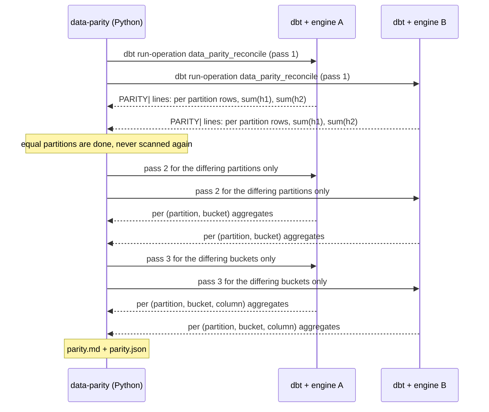
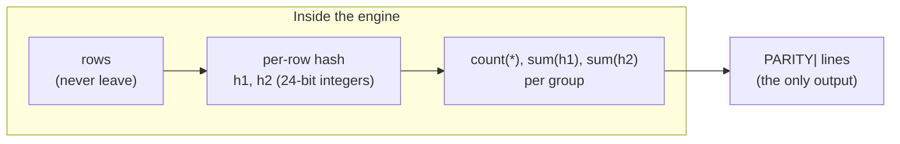

data-parity answers one question: *are table T on engine A and table T on engine B the same?* It does so by
comparing small aggregates, never rows.

## The data flow



Each engine runs **its own SQL, through its own dbt**, and prints text lines prefixed `PARITY|`. The CLI keeps those
lines, discards everything else dbt printed, and compares the two sets. No credentials of one engine are ever
given to the other, and there is no connection between them.

## What leaves an engine



A `PARITY|` line looks like this (real, from the test bed):

```text
part|2025-01-11|rows=1667|h1=13780073098|h2=14154973472
```

The report contains such counts and sums, **partition values** (here a date), **bucket numbers** and **column
names**. It never contains a row, a key or a business value. If your partition values are sensitive, partition on
a coarser column.

## The two pieces

1. **A portable row hash** (dbt macros `data_parity_canonical`, `data_parity_row_hash_parts`). Every column is first
   turned into a canonical text that is the same on every supported engine, then the row is hashed with MD5. See
   [The row hash and canonical form](/data-parity-docs/concepts/row-hash/).
2. **A drill-down** (macro `data_parity_reconcile`, driven by the CLI). Sums of hashes are order independent, so
   two tables agree on a group only if they hold (up to a collision) the same multiset of rows. The CLI starts with
   one coarse grouping and refines only where the aggregates disagree. See
   [Partitions, buckets and the three passes](/data-parity-docs/concepts/passes/).

## Why not `audit_helper` or `EXCEPT`

`audit_helper` compares two relations visible to **one** dbt connection, typically in one warehouse. It cannot compare
BigQuery with DuckDB, or Trino with BigQuery, without moving data, and its row-level comparisons go through
`EXCEPT` or joins on the rows themselves. data-parity exists for the case where the data cannot be copied or
exported and only small outputs can be shared.

## Where it runs and what it needs

- It calls `dbt run-operation` on each side, so everything dbt needs (profiles, credentials, network) must already
  work for that target.
- The mode described here **writes nothing** to either engine. Only the optional
  [closed-partition cache](/data-parity-docs/concepts/cache/) writes, and only when you pass `write: true` to a macro run by hand: the CLI
  does not use the cache.
- The comparison is deterministic: no sampling in the hash, no randomness (the only sampling is the choice of which
  differing partitions to drill when there are more than `--drill-limit`, and it is evenly spaced, not random).
