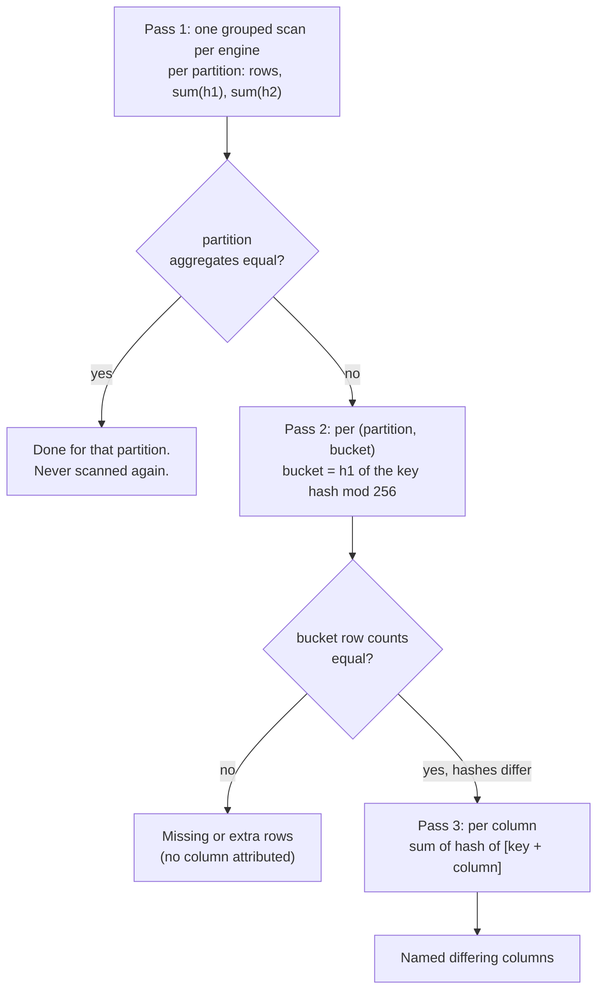

The CLI never scans more than it needs. It runs up to three passes, each only on what the previous one flagged.

| Pass | Query on each engine | Scope |
|---|---|---|
| 1 | **One** grouped scan: per partition `count(*)`, `sum(h1)`, `sum(h2)`. The `table` line is the sum of the partition lines. | the whole table (or the `--last` / `--as-of` scope) |
| 2 | Per `(partition, bucket)`, where the bucket is the hash of the primary key modulo `--buckets` (default 256) | the differing partitions, at most `--drill-limit` (default 200) per model |
| 3 | Per column: the sum of the hash of `[key columns + that column]`, per bucket | buckets whose row counts are **equal** but hashes differ |

A model whose pass 1 is equal is never scanned again. A model with no partition column gets only a `table` line in
pass 1 (the report says *table-level difference*), then buckets are taken table-wide.

## Partition columns

The partition column is `meta.data_parity.partition_column`, or else `config.event_time`. Supported types: `date`,
`timestamp`, `integer`, `string`. For timestamps the partition is the calendar day (`cast(col as date)`; UTC on
BigQuery, session time zone on DuckDB and Trino for `timestamptz`). Rows with a NULL partition are reported as a
separate partition and excluded by `--as-of`.

:::tip[Prefer a DATE partition column on BigQuery]
On BigQuery the cache's partition predicates are written on the raw column when it is a DATE so pruning can
apply; with a TIMESTAMP the cast may not prune.
:::

`--last N` orders partitions numerically for integers and as text for strings, which is chronological only for
ISO-like values (`2025-01-31`, `202501`).

## Buckets and keys

The bucket of a row is `mod(h1 of the primary-key columns' row hash, buckets)`. Without a primary key the bucket
comes from the hash of the whole row: a changed row then appears in **two** buckets (its old and its new version),
and pass 3 runs over the whole partition instead.

The primary key is `meta.data_parity.primary_key`, or inferred from a `unique` test or a
`dbt_utils.unique_combination_of_columns` test. Both sides must use the same `--buckets` (the CLI guarantees it).

## When there are too many differing partitions

Past `--drill-limit` differing partitions, the CLI drills a **sample** spread evenly from the first to the last
differing partition (first and last included). The report says so in **Not checked** and in the wording *sampled
days*. This is the subject of the [real example](/data-parity-docs/example/agg-daily-fuel/), including why even spacing matters.

## Cost

| Pass | Cost on each engine |
|---|---|
| 1 | One scan of every hashed column of every row (on BigQuery, the bytes of those columns). Bound it with `--last` / `--as-of` or the [cache](/data-parity-docs/concepts/cache/). |
| 2 | One query over the differing partitions only. |
| 3 | One query over the flagged buckets only. |
