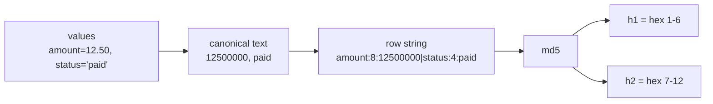

Two engines can only agree on a hash if they agree on the text that is hashed. The same `DECIMAL` or `TIMESTAMP`
prints differently on BigQuery, DuckDB and Trino, so every value is first converted to a **canonical text**, then the
whole row is assembled and hashed. The rules live in `dbt_package/macros/canonical.sql` and `row_hash.sql`
(adapter implementations `default__` for Trino/ANSI, `duckdb__`, `bigquery__`).

:::note[Validation]
The 79-row `data_parity_conformance` set gives byte-identical `PARITY|` output on DuckDB (dbt Fusion 2.0.9 and
dbt-core), BigQuery (dbt Fusion) and Trino 484 (dbt-core with dbt-trino 1.10.6, Docker, `memory` catalog).
Not tested: a real Trino cluster, and BigQuery through the reconcile and cache macros (conformance only).
:::

## Canonical text per type

`data_parity_canonical(col, data_type, scale=6)`. Type names are matched case-insensitively on the base name
(parameters after `(` are ignored).

| Type class | Canonical text | Limits |
|---|---|---|
| NULL | sentinel `\N` | A real string equal to `\N` has the same canonical text, but the row hash does not confuse them (see below). |
| boolean | `1` / `0` | |
| integers | decimal text | Beyond int64 only if the engine has such types. |
| decimal / numeric / bignumeric | the integer `round_half_away(x, scale) * 10^scale`, in exact decimal arithmetic | Half away from zero (`-0.0000005` becomes `-1`, `0.0000004999` becomes `0`). More than 38 digits after scaling is an engine error, not a silent wrong answer. |
| float / double / real | the integer `round_half_away(x * 10^scale)` computed in IEEE double; `NaN`, `Inf`, `-Inf` as words; `-0.0` as `0` | Never printed raw. If `abs(x * 10^scale) >= 2^53` the integer is not exactly representable and Trino differs from DuckDB and BigQuery: excluded from the conformance set. A float32 column compared with a float64 column is **not** equal. |
| date | `YYYY-MM-DD` | Years outside 0001-9999 untested. |
| timestamp / timestamptz / datetime | epoch microseconds in UTC, as integer text | Naive types are read as UTC. Below the microsecond Trino rounds and DuckDB truncates. A naive timestamp equals a tz-aware one only if the data/session is UTC. |
| string | as is (UTF-8 code points) | No collation, trim or unicode normalisation: `'x '` differs from `'x'`, `''` from NULL, NFC `é` from NFD `é`. Fixed-width `CHAR(n)` padding differs between engines: cast upstream. |
| array, struct, map, json, bytes, interval, geography, other | compile error `data_parity: unsupported column type '...'` | Exclude the column with `exclude_columns`. |

Floats at scale 6 mean that two floats closer than about 1e-6 (after rounding to 6 decimals) hash identically:
this is deliberate, to tolerate harmless last-bit noise, and it is also a **blind spot** for float differences
smaller than that. Declare types faithfully: a wrong type hint changes the arithmetic path.

## The row string and the two hashes

1. Columns are sorted by `lower(name)` (two columns that differ only by case are not supported).
2. Each column becomes a piece: `<lower(name)>:N` if NULL, otherwise `<lower(name)>:<length>:<canonical text>`, where
   `length` is the character count. The length prefix makes the `|` join unambiguous with no escaping, so a `|` or
   digits inside a string cannot create a collision.
3. The pieces are joined with `|` and hashed with MD5.
4. `h1` is hex characters 1 to 6 of the MD5, as an integer; `h2` is characters 7 to 12. Both are in [0, 2^24).

Per group, an engine prints `count(*)`, `sum(h1)`, `sum(h2)`. The sums do not depend on row order and cannot
overflow a 64-bit integer below about 2^39 rows.

## Columns that are never compared

By default every column whose name starts with `meta_` is excluded (load timestamps and the like).
`meta.data_parity.exclude_prefixes` and `exclude_columns` change that: see
[Configure your models](/data-parity-docs/guides/configure-models/). Excluded columns are listed in the report under
**Not checked**.
