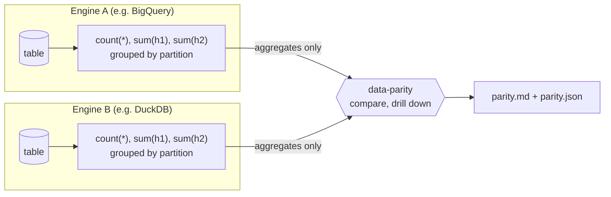

import { Card, CardGrid } from '@astrojs/starlight/components';

<CardGrid>
  <Card title="Only aggregates leave an engine" icon="shield">
    Each engine prints a row count and two hash sums per group. No row, key or business value is exported.
  </Card>
  <Card title="Portable row hash" icon="approve-check">
    Byte-identical on DuckDB, BigQuery and Trino in the conformance test (BigQuery: inline test and one manual run, no automated suite).
  </Card>
  <Card title="Drill-down" icon="magnifier">
    Partition, then bucket, then column: it names the partitions, buckets and columns that differ.
  </Card>
  <Card title="Works from PowerShell" icon="laptop">
    The CLI is plain Python and calls dbt without a shell. The PowerShell snippets were not tested.
  </Card>
  <Card title="Closed-partition cache" icon="rocket">
    Optional and manual: skip partitions that are closed and unchanged.
  </Card>
  <Card title="Honest limits" icon="information">
    Early software (0.1.0); see the status section below and the engine support matrix.
  </Card>
</CardGrid>

## The idea

Each engine hashes every row with the same portable recipe and prints only **aggregates of those hashes**
(a row count and two sums, per group). The two small outputs are compared. Where they differ, the tool asks each
engine for finer aggregates (per bucket, then per column) until it can name the partitions, buckets and columns
that differ. No row, no key and no business value ever leaves an engine.



It is a dbt package (the SQL that runs inside each engine) plus a small Python command line (no third-party
Python dependency) that calls dbt on both sides, compares, drills down and writes a report.

## Three commands

```bash
pip install "git+https://github.com/camlebrun/data-parity"   # not on PyPI
data-parity conformance --a dev --b local        # is the hash portable between these two engines?
data-parity run my_model --a dev --b local       # compare, drill down, write parity.md
```

`dev` and `local` are dbt targets (one per engine) from your `profiles.yml`. The full walk-through, including the
`packages.yml` entry the dbt package needs, is in [Quickstart](/data-parity-docs/getting-started/quickstart/).

## What you get

```text
orders                   DIFF
  rows        : engine_a = 200,000, engine_b = 199,998 (delta -2)
  partitions  : 5 of 120 differ (2025-01-11 -> 2025-03-02)
  nature      : 2 with missing/extra rows, 3 with changed values only
  columns     : amount (1), price_float (1), status (1)  [partitions with changed values: 3]

RESULT: DIFFERENCES: 3 of 3 models differ
```

That is real output on the repository's test bed (two DuckDB files with deliberate corruptions, see
[Test bed](/data-parity-docs/contributing/test-bed/)). Exit code `1`. The Markdown report adds a ranked column list, a timeline and
the exact differing partitions: see [Reading the report](/data-parity-docs/getting-started/reading-the-report/), and
[a real run on a production-shaped model](/data-parity-docs/example/agg-daily-fuel/).

## Where to go next

- [Install](/data-parity-docs/getting-started/install/) and [Quickstart](/data-parity-docs/getting-started/quickstart/)
- [How it works](/data-parity-docs/concepts/how-it-works/) and [what is guaranteed](/data-parity-docs/concepts/guarantees/)
- [CLI reference](/data-parity-docs/reference/cli/) and [macros](/data-parity-docs/reference/macros/)
- [Example: BigQuery vs DuckDB on a real daily aggregate](/data-parity-docs/example/agg-daily-fuel/)

## Status and limits

:::caution[Read this before relying on it]
- **Early software.** Version 0.1.0, not published on PyPI. Install from the public GitHub repository (`pip install "git+https://github.com/camlebrun/data-parity"` was run successfully).
- **BigQuery**: the inline [conformance](/data-parity-docs/contributing/new-engine/) test (byte-identical to DuckDB and Trino)
  plus one real manual run of `data-parity run` with a BigQuery table as side A against a DuckDB table, read-only. No
  automated test of the repository covers BigQuery. The cache `bigquery__` code was never run, and cache writes on
  BigQuery are untested.
- **Trino** was tested on one Docker container (Trino 484, `memory` catalog), never on a real cluster.
- **dbt Fusion has no Trino support**; Trino needs dbt-core and dbt-trino.
- **Windows / PowerShell** commands have never been run. Python 3.9 is the declared minimum and has not been run.
- An "identical" verdict is a statement about **hashes of canonical row text**, up to a collision probability
  and up to the documented [cross-engine non-equalities](/data-parity-docs/concepts/guarantees/). It is not a proof of semantic equality.
:::

See the [engine support matrix](/data-parity-docs/reference/engine-matrix/) for the full table.
